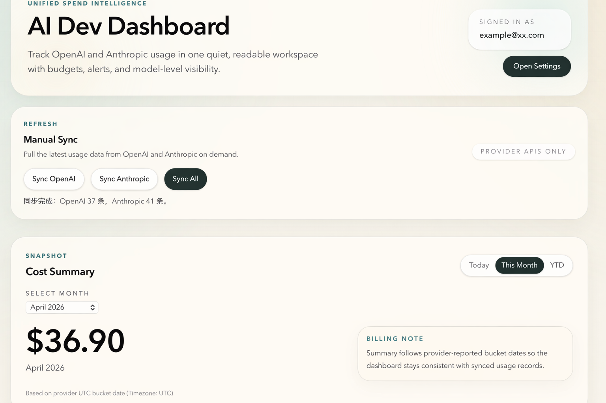
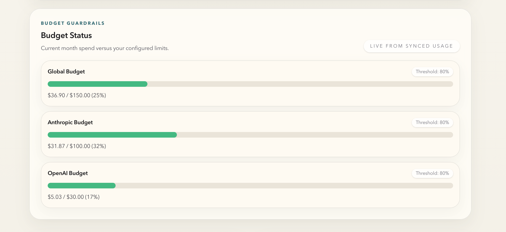
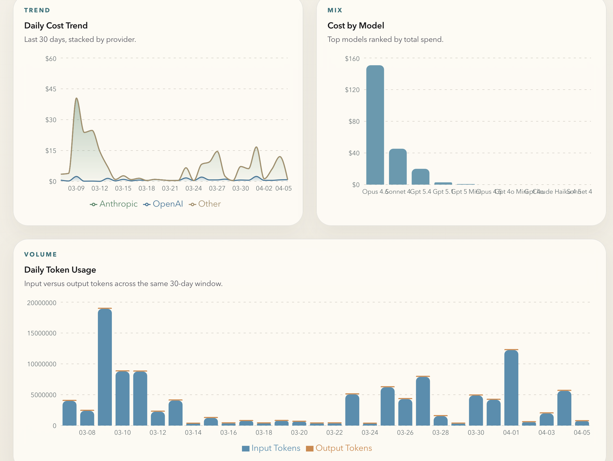

# AI Dev Dashboard

`Tech Stack: Next.js / TypeScript / PostgreSQL (RDS) / Cognito / Recharts`

A unified API spend monitoring dashboard for AI developers, bringing usage and cost data from providers like OpenAI and Anthropic into one place.








## Project Goal
When you use multiple AI APIs at the same time, you should not need to log into each provider separately to check billing and usage. This dashboard gives you one place for unified visibility, budget management, and basic alerts.

## Problems It Solves
- Pulls fragmented OpenAI and Anthropic spend into one dashboard
- Makes monthly spend and budget drift visible earlier
- Gives a clearer provider-level and model-level view of usage patterns

## Core Features
1. **Multi-provider data aggregation**
   - Connects to OpenAI and Anthropic organization-level usage / cost APIs
   - Pulls, normalizes, and stores usage and cost data in a unified format
2. **Visual dashboard**
   - Cost Summary (Today / This Month / YTD)
   - Daily Cost Trend
   - Cost by Model
   - Daily Token Usage
3. **Budget alerts**
   - Global budget
   - Per-provider budget
   - Progress bars and threshold warnings
4. **API key management**
   - Save and update OpenAI / Anthropic keys
   - Server-side encrypted storage
   - Manual sync actions
5. **User authentication**
   - Cognito hosted sign-in for provisioned dashboard accounts
   - Per-user data isolation
6. **Raw record inspection**
   - Dedicated Records page for recently synced usage rows

## Architecture Highlights

### RLS row isolation
PostgreSQL Row Level Security scopes providers, budgets, and usage records to the verified Cognito subject. Each private operation sets `app.user_id` locally inside a transaction on one checked-out connection. The public snapshot uses a separate, read-only database account. Runtime accounts cannot provision users or publish snapshots. This relies on a trusted server with parameterized queries; it does not protect against leaked runtime credentials. Live role-isolation tests are still pending.

### AES-256-GCM key encryption
Provider API keys are encrypted before they are written to the database and decrypted only on the server when a sync runs. This keeps sensitive provider credentials out of plaintext storage while staying simple enough for a small server-hosted application.

### Upsert idempotent sync
Sync routes are designed to be safe to run repeatedly by upserting normalized usage rows instead of blindly inserting duplicates. That keeps manual re-syncing practical when validating provider data or catching up after API delays.

### Model name canonicalization
Provider responses are inconsistent about model names, aggregation rows, and billing labels, so the sync pipeline normalizes those values before storing and charting them. This makes the dashboard totals and model comparisons much more stable across OpenAI and Anthropic.

## Tech Stack
- **Frontend:** Next.js 16 (App Router) + TypeScript + Tailwind CSS 4 + Recharts
- **Backend / Database:** PostgreSQL on Amazon RDS + Cognito authentication
- **Deployment:** ARM64 Docker on EC2, with Caddy HTTPS and private RDS access
- **API sources:** OpenAI Organization Usage / Costs API, Anthropic Usage / Cost Report API

## Current Status

### Original application baseline

The original Supabase/Vercel version delivered these features. The current branch
replaces its runtime data and authentication paths with RDS/Cognito and is deployed
at [dashboard.kazezi.com](https://dashboard.kazezi.com). Login, private data,
budget updates, public showcase content, and both provider syncs have passed
manual acceptance. Automated deployment and a live rollback drill are pending.

1. Next.js + TypeScript + Tailwind project setup
2. Supabase Auth, PostgreSQL, and RLS setup
3. OpenAI usage / cost sync
4. Anthropic usage / cost sync
5. Dashboard charts and summary views
6. Global budget + per-provider budget alerts
7. Settings page for provider keys and budgets
8. AES-256-GCM encrypted API key storage
9. Dedicated Records page
10. Light-theme UI redesign
11. Vercel production deployment

### Roadmap
- Add more advanced records filtering and search
- Support automated scheduled sync
- Expand automated test coverage around provider parsing and sync flows

## Local Development

### AWS migration status

This branch uses Cognito and RDS for application requests. The initial schema
and imported data are in RDS. Local code checks do not establish live database
role isolation or confirm the final source-data cutover. The user has confirmed
Cognito login, private data display, and live OpenAI/Anthropic sync after saving
provider keys again. The same flows have now been checked on the EC2 deployment.
RDS public access is disabled, and its database ingress allows only the EC2
application security group. Local database access now requires a tunnel through
EC2 or another authorized private-network path. No local PostgreSQL is required.
The source Supabase project and backup are retained.

### 1. Install dependencies
```bash
npm install
```

### 2. Configure environment variables
Create a `.env.local` file in the project root:

Use `.env.example` as a reference. If `.env.local` already exists, keep its
values, especially the encryption secret needed to decrypt existing API keys.

Configure all server-only values shown in `.env.example`:

- `APP_ORIGIN` and the Cognito pool issuer, hosted domain, client ID and client secret.
- `COGNITO_SESSION_SECRET`: a separate 32-byte base64 secret for encrypted session cookies.
- `DATABASE_HOST`, `DATABASE_PORT`, `DATABASE_NAME`, `DATABASE_USER=dashboard_app`, and its password.
- `SHOWCASE_DATABASE_USER=dashboard_public` and its separate password.
- `DATABASE_CA_CERT_PATH`: absolute path to the trusted RDS CA bundle. TLS verifies both the certificate and host.
- `API_KEY_ENCRYPTION_SECRET`: retain the value used when the currently saved provider keys were encrypted. The original imported keys could not be decrypted with the local secret; saving the keys again restored sync. Use this same current secret when deploying to EC2.

Register `<APP_ORIGIN>/auth/cognito/callback` as the Cognito callback and
`<APP_ORIGIN>/auth/cognito` as the sign-out URL. The latter redirects to `/login`.
Sessions expire with the ID token; users then sign in again. Browser refresh
preserves an unexpired session but does not renew it.

Never use an administrator or table-owner account in the application. New Cognito
subjects must be registered in `app_users` through a separately reviewed owner
operation. Existing imported users already have this registration. The application
does not grant database access to newly created Cognito accounts automatically.

### 3. Start the development server
```bash
npm run dev
```

Default local URL:

```bash
http://localhost:3000
```

Use the port matching `APP_ORIGIN` and the registered Cognito URLs. If 3000 is occupied, stop the existing development server or update all three settings together. Restart the development server after changing `.env.local`.

### 4. Run the project checks

```bash
npm run check
```

This runs ESLint (zero warnings allowed), generated Next.js route types,
TypeScript, Vitest, and the production build. Tests use fake credentials and mocked
connections; they do not contact AWS or modify real data. The build does not query
the database. A running application needs the configured RDS network access.

## Continuous integration

`.github/workflows/ci.yml` runs for pushes and pull requests targeting
`main` or `AWS-update`, plus manual runs. It runs on a
GitHub-hosted ARM64 Linux runner with Node.js 26. It installs the lockfile, runs
`npm run check`, audits production dependencies (high/critical findings fail),
builds the ARM64 Docker image, and verifies its architecture and non-root user.
Actions are pinned to full commit hashes, and the workflow token is read-only.
No AWS, database, provider, or SSH credentials are required.

The workflow has passed local syntax validation; the checks also pass in a clean
directory without `.env.local`. See the repository's
[Actions runs](https://github.com/Kaze310/ai-dev-dashboard/actions/workflows/ci.yml)
for hosted results. CI does not push images to ECR or deploy to EC2. Automated
deployment is deferred; releases remain manual. A live rollback drill is pending.

## Docker application packaging

The Dockerfile uses Node.js 26 and Next.js standalone output in a multi-stage
build. The final image runs as the unprivileged `node` user and contains the
standalone server, traced runtime dependencies, and static assets. The
`.dockerignore` allowlist excludes local environment files, certificates, backups,
Git history, migration notes, and host dependencies from the build context.
The ARM64 image has been built, pushed to ECR, and deployed to EC2. Both runtime
database accounts have been independently checked for successful TLS connections
to the private RDS address. This is not a complete image security review or a
substitute for the pending live role-isolation tests.

`compose.yaml` runs only the application. It does not create a PostgreSQL container
or run migrations. It mounts `.env.local` and the existing RDS CA bundle read-only
at startup; Next.js reads the original environment file. The CA path is overridden
inside the container as `/run/certs/rds-ca.pem`. Keep the actual CA file readable
by the container's non-root user, and do not broaden permissions on private keys
or the environment file to solve mount problems.

### Build and start (when ready)

Install and start [Docker Desktop for Apple silicon](https://docs.docker.com/desktop/setup/install/mac-install/).
Run these commands from the project root. Building downloads dependencies and
compiles the app; it does not need live AWS or provider credentials:

```bash
docker build --pull -t ai-dev-dashboard:local .
```

Before starting, stop the existing `npm run dev` process using Ctrl+C in its
terminal so port 3000 is available. Keep `APP_ORIGIN=http://localhost:3000` and
the existing Cognito localhost callback/logout URLs. In `.env.local`,
`DATABASE_CA_CERT_PATH` must point to an existing absolute path on the Mac.

```bash
docker compose --env-file .env.local up -d --no-build
```

The `--env-file` option supplies the host CA path for Compose interpolation.
Secrets are read from the mounted file at application startup, not baked into the
image. Avoid exporting a different `DATABASE_CA_CERT_PATH` in the shell, because
shell variables take precedence for Compose interpolation. Do not print/share
resolved Compose configuration or environment values containing credentials.
After editing `.env.local`, restart the app to reload configuration; if the CA
path changes, recreate the container with the command above plus `--force-recreate`.

```bash
docker compose --env-file .env.local restart app
docker compose --env-file .env.local logs --tail=100 app
```

Open [http://localhost:3000](http://localhost:3000). The local port is bound only
to loopback. RDS is now private; local development requires a separately configured
SSH tunnel or another authorized private-network connection. The commands above
alone do not establish that connection. EC2 login, data, sync, budget, and showcase
flows have passed manual acceptance.

To stop/remove the application container and return to local development:

```bash
docker compose --env-file .env.local down
npm run dev
```

This does not delete the RDS database or roll back any business data written while
the container was running. The source checkout and host dependencies remain intact.

### CPU architecture and deployment

A normal build on Apple silicon produces a Linux ARM64 image. An ARM64 EC2 instance
can run that architecture; an x86 EC2 instance requires a separate `linux/amd64`
build. The current EC2 deployment uses ARM64. CI builds and checks that architecture
without publishing the image. The `local` tag is for development; manually released
ECR images use separate version tags. EC2 runs the application and Caddy using
`compose.ec2.yaml` plus `compose.https.yaml`. HTTPS and private RDS connectivity are
verified. Automatic deployment and a live rollback drill remain deferred/pending.

References: [Next.js standalone output](https://nextjs.org/docs/pages/api-reference/config/next-config-js/output),
[Docker multi-stage builds](https://docs.docker.com/build/building/multi-stage/).

## Database Migrations
The RDS target schema is `db/migrations/001_initial.sql`. It is a one-time schema
creation script for an empty database with pre-provisioned `dashboard_owner`,
`dashboard_runtime` and `dashboard_showcase` groups. Do not rerun it on the imported
database. Login accounts inherit only their corresponding runtime/showcase group.

`supabase/migrations/` contains historical source migrations, not instructions
for updating RDS. The legacy SDK helpers/dependencies are retained for later cleanup;
application routes no longer import them. Do not replay historical capture/cleanup
scripts against the source project during this migration.

## Public Showcase

The public `/showcase` route reads one curated aggregate snapshot. It does not query raw usage records, provider credentials, user email addresses, or account IDs.

The public page reads the imported singleton snapshot at request time through
`dashboard_public`, without using a private session or private database credentials.
It includes total synced spend, token volume, provider totals, model-family totals,
and a 90-day trend. Syncing private records does not republish this snapshot;
publication is a separate owner operation. Database failure shows the unpublished
fallback, and does not fall back to private data.

## API Key Requirements
- OpenAI usage / cost sync requires an **Admin API key**
- Anthropic usage / cost sync requires an **organization admin key**
- A normal project key may save successfully, but it will not be able to fetch organization-level reports

## Security Notes
- Provider keys are stored in `providers.api_key_encrypted`
- Keys are encrypted server-side using `AES-256-GCM`
- Historical plaintext keys are not supported; before deploying the encrypted version, old provider records should be cleared and re-entered

## Known Limitations
- `usage_records.date` uses the provider's UTC bucket date, so it may differ by one day from the user's local calendar date
- Anthropic same-day data may appear later than the Anthropic console and may require syncing again later or the next day
- Anthropic `input_tokens` includes cache-creation and cache-read tokens, so the input token count is intentionally broader than the console's "input" column
- Costs that cannot be matched to a usage row (e.g. embeddings, web search, code execution) are stored as synthetic records with zero tokens so spend totals stay accurate

## Tests
```bash
npm test
```
Tests cover provider normalization and cost conservation, OAuth signature/claim
validation, cookie expiry/tampering, API authentication and origin checks, transaction
cleanup, separate database configuration, and sync failure handling. These tests do
not replace live RLS or end-to-end migration acceptance.

## Project Boundaries
- No real-time streaming monitoring
- No API proxy / request forwarding
- No multi-tenant SaaS features
- Built as a personal tool, not optimized for large-scale users
